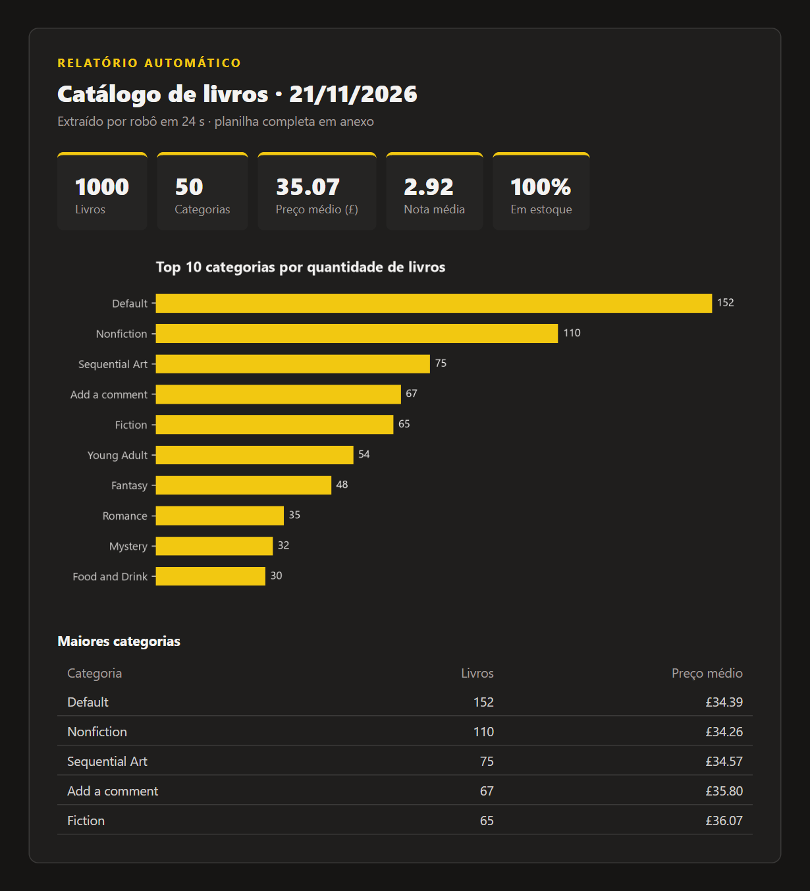

<!-- rayrafaneli.pbix · relatório de perfil -->
<p align="center">
  
</p>

<p align="center">
  <a href="#sobre"></a>
  <a href="#stack"></a>
  <a href="#dados"></a>
  <a href="#rpa"></a>
  <a href="#metricas"></a>
  <a href="#contato"></a>
</p>

<p align="center">
  <a href="https://www.linkedin.com/in/raywa-rafaneli/"></a>
  <a href="mailto:raywarafaneli@gmail.com"></a>
  
  
</p>

<br/>

<h2 id="sobre"></h2>


Sou **Raywã**, profissional de **dados** com um pé em cada ponta do pipeline: **engenharia de dados** (ETL, SQL, modelagem), **ciência de dados** (estatística, séries temporais e modelos de previsão) e **BI** para colocar o resultado na mão de quem decide. Hoje trabalho com **Análise de Dados e Automação na Embraer**, na área de **Supply Chain**.

O que eu faço:

- 🛠️ **Engenharia de dados**: pipelines de ETL com **Pentaho PDI** e **Python**, **Oracle SQL**, **PostgreSQL**, **MySQL** e modelagem dimensional
- 📐 **Ciência de dados**: estatística inferencial, testes de hipótese, séries temporais (**SARIMA**), **XGBoost** e validação walk-forward
- 📊 **BI**: dashboards em **Power BI** (nível avançado: DAX, Power Query), **Metabase** e **Streamlit**
- 🤖 **Automação (RPA)**: robôs no **SAP** com SAP GUI Scripting, Python e VBA, OCR de documentos e e-mails automáticos
- 🌐 **Web & .NET**: painéis em **HTML, CSS e JavaScript**, aplicações em **ASP.NET** e **VB.NET**

🎓 Ciência da Computação na **UNIP** (2023–2027) · TCC de **predição de dengue com Machine Learning**, aprovado com **nota 10**.

```diff
+ dados limpos, modelados e com teste de qualidade
+ previsão com estatística antes de modelo complexo
+ robôs fazendo o trabalho repetitivo
- planilha manual (estou automatizando)
```

<br clear="right"/>

<details>
<summary><b>🏅 12 certificações</b> (clique para ver)</summary>
<br/>

| Certificação | Emissor | Data |
|---|---|---|
| Power BI & Análise de Dados | Embraer | jul/2025 |
| BI: Decisões Estratégicas | Embraer | jun/2025 |
| Jornada de Inteligência Artificial | Embraer | jun/2025 |
| Data Protection (LGPD/GDPR) | Embraer | abr/2025 |
| O Pensamento Lean | Embraer | abr/2025 |
| Pandas: transformação e manipulação de dados | Alura | jun/2025 |
| Fundamentos do Apache Spark | Alura | mai/2025 |
| Dashboards com Metabase | Udemy | mai/2025 |
| Python Básico ao Avançado + RPA | Udemy | abr/2025 |
| SQL Server / Azure SQL Database e Power BI (97h) | Udemy | nov/2024 |
| Versionamento de código com Git e GitHub | DIO | jul/2024 |
| Princípios de Desenvolvimento de Software Colaborativo | DIO | jul/2024 |

</details>

<br/>

<h2 id="stack"></h2>

<p align="center">
  
</p>

<p align="center">
  
</p>

<br/>

<h2 id="dados"></h2>

### 📐 [Previsão de inflação (IPCA)](https://github.com/rayrafaneli/previsao-inflacao-bcb) &nbsp;`estatística · séries temporais · ML`

Estudo de ciência de dados com 22 anos de dados do Banco Central. Testa **estacionariedade** (ADF e KPSS), decompõe a série com **STL**, mede a sazonalidade com **intervalos de confiança de 95%**, analisa **ACF/PACF** e compara **6 modelos** (naive sazonal, média móvel, **SARIMA**, **Ridge**, **XGBoost** e ensemble) em **backtest walk-forward** de 36 meses. A significância das diferenças é verificada com o **teste de Diebold-Mariano**, e a projeção de 12 meses sai com intervalos de 80% e 95%. Spoiler honesto: o naive sazonal é uma referência difícil de bater.

<p>
  
  
  
  
  
  
  
</p>

<a href="https://github.com/rayrafaneli/previsao-inflacao-bcb"></a>

---

### 🛠️ [Pipeline de indicadores econômicos](https://github.com/rayrafaneli/pipeline-indicadores-bcb) &nbsp;`engenharia de dados · ETL · modelo estrela`

Pipeline de ponta a ponta: extrai 6 séries oficiais da **API do Banco Central** (Selic, IPCA, dólar, desocupação, IBC-Br), transforma em um **modelo estrela mensal**, carrega no **DuckDB** com views analíticas em **SQL** (window functions, juro real), roda **checagens de qualidade** (nulos, duplicidade, integridade referencial, defasagem) e alimenta um painel com cara de Power BI. Atualiza sozinho no GitHub Actions.

<p>
  
  
  
  
  
  
  
</p>

<a href="https://github.com/rayrafaneli/pipeline-indicadores-bcb"></a>

---

### 🦟 [Epidemiological Forecaster](https://github.com/rayrafaneli/epidemiological-forecaster) &nbsp;`TCC · nota 10 · predição`

Projeto em grupo que **prevê casos de dengue e classifica o risco nos bairros do Recife**. Junta dados climáticos do INMET, população do IBGE e notificações do DATASUS num banco **PostgreSQL**; um pipeline de features com defasagens de chuva e temperatura alimenta um modelo **XGBoost**, servido por uma **API em FastAPI**, e o painel em **Streamlit** mostra KPIs, mapa de calor, ranking de bairros e pressão hospitalar.

<p>
  
  
  
  
  
  
</p>

<a href="https://github.com/rayrafaneli/epidemiological-forecaster"></a>

<br/>

<h2 id="rpa"></h2>

### 🏭 RPAs corporativos em SAP &nbsp;`em produção`

No trabalho, automatizo rotinas de Supply Chain que antes eram manuais: robôs em **Python** e **VBA** que operam o **SAP ERP** via **SAP GUI Scripting** (consultas e atualizações em transações, leitura de grids, exportação de relatórios), leem a caixa do **Outlook**, extraem dados de **PDFs com OCR**, cruzam informações no **Oracle SQL**, geram planilhas e mandam **e-mails automáticos** com o status. O acompanhamento fica em **painéis web em HTML, CSS e JavaScript**. O código é da empresa, então aqui vai o desenho do fluxo:

<p align="center">
  
</p>

---

### 🤖 [RPA Challenge](https://github.com/rayrafaneli/rpa-challenge-python) &nbsp;`100% · 70/70 campos`

Robô em **Python + Playwright** que resolve o [RPA Challenge](https://rpachallenge.com/): baixa a planilha pelo próprio site, lê os registros com **openpyxl** e preenche 10 formulários cujos campos **mudam de posição a cada envio**. O robô encontra cada campo pelo nome lógico, nunca pela posição, e fecha com **100% de acerto em ~0,7 s**. Testes com pytest e execução agendada no GitHub Actions.

<p>
  
  
  
  
</p>

<a href="https://github.com/rayrafaneli/rpa-challenge-python"></a>

---

### 📚 [Robô de catálogo → relatório Excel](https://github.com/rayrafaneli/robo-catalogo-excel) &nbsp;`1.000 itens · 24 s`

RPA que navega um catálogo web inteiro como um usuário (50 categorias, seguindo a paginação), consolida **1.000 registros** e entrega um **relatório Excel** com KPIs, formatação condicional e gráficos nativos, mais um **e-mail HTML** com o resumo e a planilha anexada (SMTP). Roda todo dia útil no GitHub Actions.

<p>
  
  
  
  
  
</p>

<p align="center">
  <a href="https://github.com/rayrafaneli/robo-catalogo-excel"></a>
  
</p>

---

### 🎬 auto-videos · fábrica de vídeos + Central de KPIs &nbsp;`repositório privado`

Operação de **vídeos curtos 100% automatizada** para quatro canais no YouTube: roteiro, narração e render com **ffmpeg** em piloto automático no **GitHub Actions**, com aprovação pelo **Telegram**. Um coletor grava os KPIs a cada 6 horas num **SQLite** versionado; a **Central de KPIs** (Streamlit + Plotly) mostra inscritos, views, retenção e produção diária, e o próprio robô usa esses números para escolher temas e formatos dos próximos vídeos.

<p>
  
  
  
  
  
  
</p>


---

### 🧩 Mais projetos

| Projeto | O que faz | Stack |
|---|---|---|
| **ConformAI** · HackaEmb 2026 | Hackathon de 5 dias com 14 equipes: visão computacional que avalia as imagens anexadas a notas de não conformidade e sugere o preenchimento dos campos obrigatórios | Python · IA · Visão computacional |
| **Chat cliente-servidor** <sub>privado</sub> | Chat em Java com sockets, salas e múltiplos clientes (UNIP) | Java · Maven · Sockets |
| [**biometric-auth-system**](https://github.com/rayrafaneli/biometric-auth-system) | Cadastro e autenticação por reconhecimento facial | Python · SQLite |

<br/>

<h2 id="metricas"></h2>

<p align="center">
  
</p>

<p align="center">
  <picture>
    <source media="(prefers-color-scheme: dark)" srcset="https://raw.githubusercontent.com/rayrafaneli/rayrafaneli/output/snake-dark.svg" />
    <source media="(prefers-color-scheme: light)" srcset="https://raw.githubusercontent.com/rayrafaneli/rayrafaneli/output/snake.svg" />
    
  </picture>
</p>

<br/>

<h2 id="contato"></h2>

<p align="center">
  Quer conversar sobre <b>engenharia de dados, ciência de dados, BI ou automação</b>? Me chama.
</p>

<p align="center">
  <a href="https://www.linkedin.com/in/raywa-rafaneli/"></a>
  <a href="mailto:raywarafaneli@gmail.com"></a>
  <a href="https://github.com/rayrafaneli"></a>
</p>

<p align="center">
  
</p>
