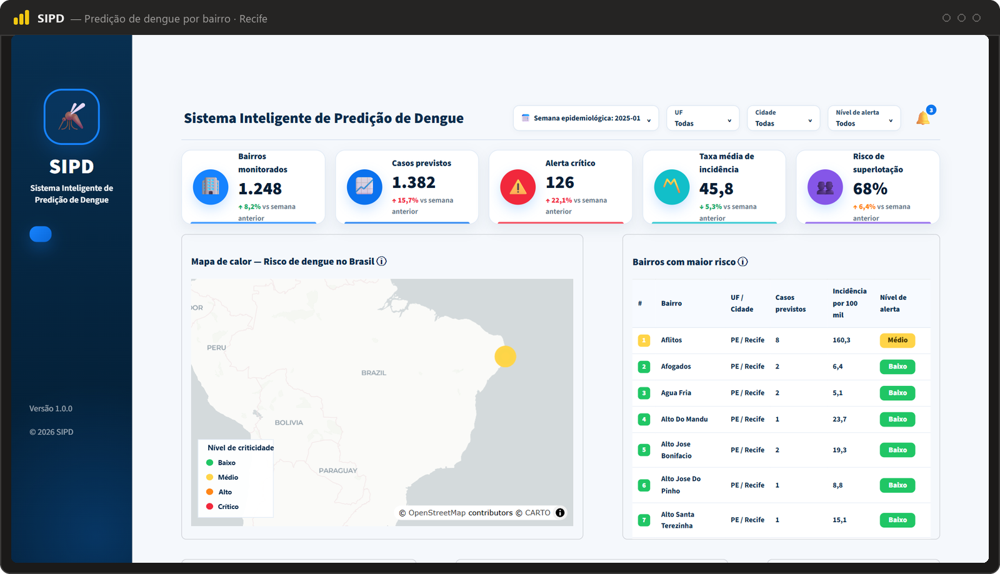
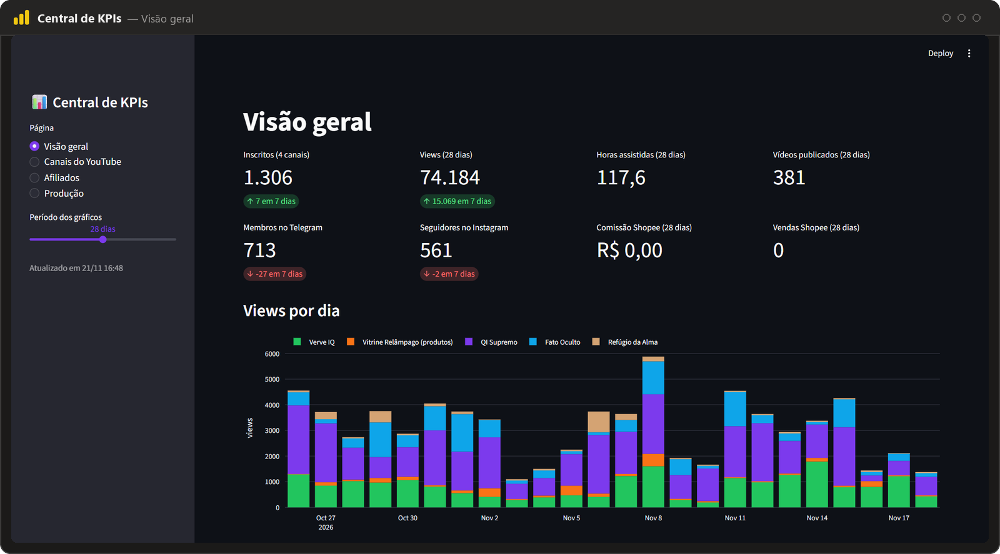
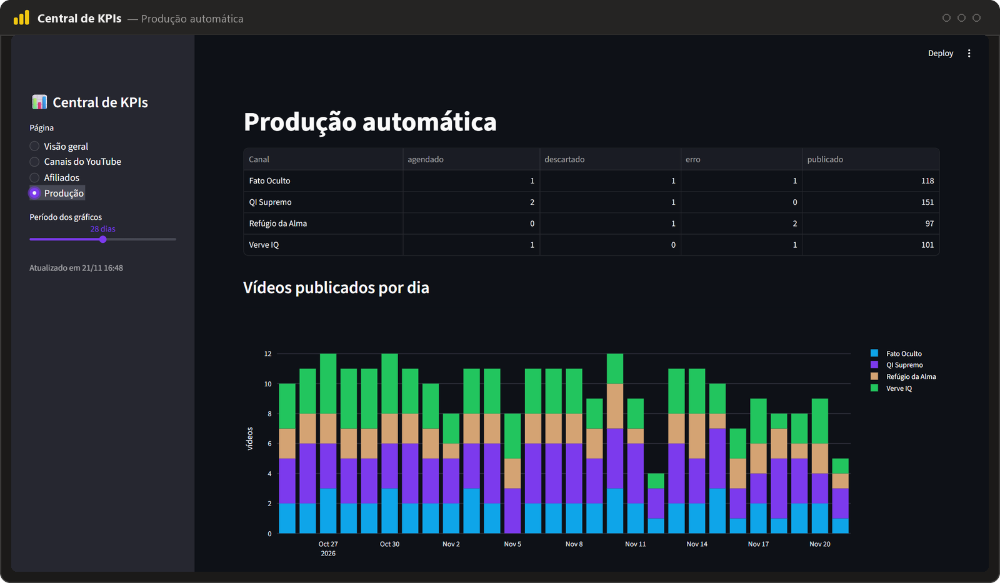

<!-- rayrafaneli.pbix · relatório de perfil -->
<p align="center">
  
</p>

<p align="center">
  <a href="#sobre"></a>
  <a href="#stack"></a>
  <a href="#projetos"></a>
  <a href="#metricas"></a>
  <a href="#contato"></a>
</p>

<p align="center">
  <a href="https://www.linkedin.com/in/raywa-rafaneli/"></a>
  <a href="mailto:raywarafaneli@gmail.com"></a>
  
  
</p>

<br/>

<h2 id="sobre"></h2>



Sou **Raywã**, trabalho com **Análise de Dados e Automação na Embraer**, na área de **Supply Chain**. Meu foco é **desenvolver BI**: transformar dado bruto em painéis que as áreas de negócio usam para decidir.

No dia a dia:

- 📊 Dashboards em **Power BI** (DAX, Power Query) e **Metabase**
- 🛢️ Extração e análise com **SQL (Oracle)** e **Python (Pandas)**
- 🔁 Rotinas de **ETL** com Pentaho Data Integration
- 🤖 Automação de processos (**RPA**) com Python, VBA e SAP GUI Scripting
- 🧱 Apoio a **modelagem e governança de dados** e adequação à **LGPD**

🎓 Ciência da Computação na **UNIP** (2023–2027) · TCC com **Machine Learning**, aprovado com **nota 10**.

```diff
+ modelando, medindo e publicando dashboards
+ aberto a conversas sobre BI, dados e automação
- planilha manual (estou automatizando)
```

<br clear="right"/>

<details>
<summary><b>🏅 12 certificações</b> (clique para ver)</summary>
<br/>

| Certificação | Emissor | Data |
|---|---|---|
| Power BI & Análise de Dados | Embraer | jul/2025 |
| BI: Decisões Estratégicas | Embraer | jun/2025 |
| Jornada de Inteligência Artificial | Embraer | jun/2025 |
| Data Protection (LGPD/GDPR) | Embraer | abr/2025 |
| O Pensamento Lean | Embraer | abr/2025 |
| Pandas: transformação e manipulação de dados | Alura | jun/2025 |
| Fundamentos do Apache Spark | Alura | mai/2025 |
| Dashboards com Metabase | Udemy | mai/2025 |
| Python Básico ao Avançado + RPA | Udemy | abr/2025 |
| SQL Server / Azure SQL Database e Power BI (97h) | Udemy | nov/2024 |
| Versionamento de código com Git e GitHub | DIO | jul/2024 |
| Princípios de Desenvolvimento de Software Colaborativo | DIO | jul/2024 |

</details>

<br/>

<h2 id="stack"></h2>

<p align="center">
  
</p>

<p align="center">
  
</p>

<br/>

<h2 id="projetos"></h2>

### 🦟 [SIPD · Sistema Inteligente de Predição de Dengue](https://github.com/rayrafaneli/epidemiological-forecaster) &nbsp;`TCC · nota 10`

Projeto em grupo que classifica o **risco de dengue nos bairros do Recife**. Junta dados climáticos do INMET, população do IBGE e notificações do DATASUS num pipeline de features; um modelo **XGBoost** prevê os casos da semana, uma **API em FastAPI** serve as previsões e o painel em **Streamlit** mostra KPIs, mapa de calor e o ranking de bairros por nível de alerta.

<p>
  
  
  
  
  
  
</p>

<a href="https://github.com/rayrafaneli/epidemiological-forecaster"></a>

---

### 📈 Central de KPIs · canais de vídeo automatizados &nbsp;`repositório privado`

Painel de acompanhamento de uma operação de **vídeos curtos 100% automatizada** (quatro canais no YouTube, Telegram, Instagram e afiliados). Um coletor roda a cada 6 horas no **GitHub Actions**, grava os retratos num **SQLite** versionado e o painel em **Streamlit + Plotly** mostra inscritos, views por dia, retenção, progresso rumo à monetização e a produção diária de cada canal. Os mesmos KPIs realimentam a escolha de temas e formatos dos próximos vídeos.

<p>
  
  
  
  
  
  
</p>

<p align="center">
  
  
</p>

---

### 🏭 Dashboards corporativos · Embraer &nbsp;`confidencial`

Desenvolvimento e manutenção de **dashboards em Power BI** (DAX, Power Query) e **Metabase** para as áreas de negócio de Supply Chain, alimentados por **SQL (Oracle)** e rotinas de **ETL em Pentaho**. Por compliance, telas e dados ficam fora do GitHub.

<p align="center">
  
</p>

---

### 🧩 Mais projetos

| Projeto | O que faz | Stack |
|---|---|---|
| **ConformAI** · HackaEmb 2026 | Hackathon de 5 dias com 14 equipes: visão computacional que avalia a qualidade das imagens anexadas a notas de não conformidade e sugere o preenchimento dos campos obrigatórios | Python · IA · Visão computacional |
| **auto-videos** <sub>privado</sub> | Fábrica de Shorts: roteiro, narração e render com ffmpeg em piloto automático no GitHub Actions, com aprovação pelo Telegram e aprendizado a partir dos KPIs | Python · ffmpeg · GitHub Actions · LLMs |
| **affiliate_bot** <sub>privado</sub> | Bot de Telegram que converte links de afiliado, varre ofertas e gera vídeos curtos para várias redes | Python · Docker · SQLite · APIs |
| [**biometric-auth-system**](https://github.com/rayrafaneli/biometric-auth-system) | Cadastro e autenticação por reconhecimento facial | Python · SQLite |

<br/>

<h2 id="metricas"></h2>

<p align="center">
  
</p>

<p align="center">
  <picture>
    <source media="(prefers-color-scheme: dark)" srcset="https://raw.githubusercontent.com/rayrafaneli/rayrafaneli/output/snake-dark.svg" />
    <source media="(prefers-color-scheme: light)" srcset="https://raw.githubusercontent.com/rayrafaneli/rayrafaneli/output/snake.svg" />
    
  </picture>
</p>

<br/>

<h2 id="contato"></h2>

<p align="center">
  Quer conversar sobre <b>Power BI, modelagem de dados ou automação</b>? Me chama.
</p>

<p align="center">
  <a href="https://www.linkedin.com/in/raywa-rafaneli/"></a>
  <a href="mailto:raywarafaneli@gmail.com"></a>
  <a href="https://github.com/rayrafaneli"></a>
</p>

<p align="center">
  
</p>
