<!-- rayrafaneli.pbix · relatório de perfil -->
<p align="center">
  
</p>

<p align="center">
  <a href="#sobre"></a>
  <a href="#stack"></a>
  <a href="#dados"></a>
  <a href="#rpa"></a>
  <a href="#metricas"></a>
  <a href="#contato"></a>
</p>

<p align="center">
  
</p>

<p align="center">
  <a href="https://www.linkedin.com/in/raywa-rafaneli/"></a>
  <a href="mailto:raywarafaneli@gmail.com"></a>
  
  
</p>

<br/>

<h2 id="sobre"></h2>


Sou **Raywã**, profissional de **dados** com um pé em cada ponta do pipeline: **engenharia de dados** (ETL, SQL, modelagem), **ciência de dados** (estatística, séries temporais e modelos de previsão) e **BI** para colocar o resultado na mão de quem decide. Hoje trabalho com **Análise de Dados e Automação na Embraer**, na área de **Supply Chain**.

O que eu faço:

- 🛠️ **Engenharia de dados**: pipelines de ETL com **Pentaho PDI** e **Python**, **Oracle SQL**, **PostgreSQL**, **MySQL** e modelagem dimensional
- 📐 **Ciência de dados**: estatística inferencial, testes de hipótese, séries temporais (**SARIMA**), **XGBoost** e validação walk-forward
- 📊 **BI**: dashboards em **Power BI** (nível avançado: DAX, Power Query), **Metabase** e **Streamlit**
- 🤖 **Automação (RPA)**: robôs no **SAP** com SAP GUI Scripting, Python e VBA, OCR de documentos e e-mails automáticos
- 🌐 **Web & .NET**: painéis em **HTML, CSS e JavaScript**, aplicações em **ASP.NET** e **VB.NET**

🎓 Ciência da Computação na **UNIP** (2023–2027) · TCC de **predição de dengue com Machine Learning**, aprovado com **nota 10**.<br/>
🏆 **HackaEmb 2026** · ConformAI: visão computacional para avaliar imagens de notas de não conformidade (hackathon de 5 dias, 14 equipes).

```diff
+ dados limpos, modelados e com teste de qualidade
+ previsão com estatística antes de modelo complexo
+ robôs fazendo o trabalho repetitivo
- planilha manual (estou automatizando)
```

<br clear="right"/>

<details>
<summary><b>🏅 12 certificações</b> (clique para ver)</summary>
<br/>

| Certificação | Emissor | Data |
|---|---|---|
| Power BI & Análise de Dados | Embraer | jul/2025 |
| BI: Decisões Estratégicas | Embraer | jun/2025 |
| Jornada de Inteligência Artificial | Embraer | jun/2025 |
| Data Protection (LGPD/GDPR) | Embraer | abr/2025 |
| O Pensamento Lean | Embraer | abr/2025 |
| Pandas: transformação e manipulação de dados | Alura | jun/2025 |
| Fundamentos do Apache Spark | Alura | mai/2025 |
| Dashboards com Metabase | Udemy | mai/2025 |
| Python Básico ao Avançado + RPA | Udemy | abr/2025 |
| SQL Server / Azure SQL Database e Power BI (97h) | Udemy | nov/2024 |
| Versionamento de código com Git e GitHub | DIO | jul/2024 |
| Princípios de Desenvolvimento de Software Colaborativo | DIO | jul/2024 |

</details>

<br/>

<h2 id="stack"></h2>

<p align="center">
  
</p>

<p align="center">
  
</p>

<br/>

<h2 id="dados"></h2>

<a href="https://github.com/rayrafaneli/previsao-inflacao-bcb"></a>
<a href="https://github.com/rayrafaneli/previsao-inflacao-bcb"></a>

> **ADF + KPSS, STL, ACF/PACF, SARIMA, Ridge, XGBoost e ensemble**, com walk-forward e teste de **Diebold-Mariano**. Spoiler honesto: o naive sazonal é uma referência difícil de bater, e o estudo mostra isso em vez de esconder.

<br/>

<a href="https://github.com/rayrafaneli/pipeline-indicadores-bcb"></a>
<a href="https://github.com/rayrafaneli/pipeline-indicadores-bcb"></a>

> Extração com retry da **API SGS**, **modelo estrela** (dim_tempo, dim_indicador, fato), views em **SQL** com window functions e **checagens de qualidade** que derrubam a carga se algo quebrar. Roda sozinho no GitHub Actions.

<br/>

<a href="https://github.com/rayrafaneli/epidemiological-forecaster"></a>
<a href="https://github.com/rayrafaneli/epidemiological-forecaster"></a>

> Features com defasagens de chuva e temperatura, **XGBoost** prevendo casos por semana epidemiológica, **API em FastAPI** sobre **PostgreSQL** e painel com mapa de calor, ranking de bairros e pressão hospitalar.

<br/>

<h2 id="rpa"></h2>



> Robôs em produção na área de Supply Chain: transações do **SAP** via GUI Scripting, leitura do **Outlook**, **OCR** de PDFs, cruzamento no **Oracle SQL**, planilhas e e-mails automáticos, com acompanhamento em painéis **HTML, CSS e JavaScript**. O código é da empresa; aqui vai o desenho do fluxo.

<br/>


> Pipeline de vídeos curtos 100% automático com aprovação pelo **Telegram**; um coletor grava os KPIs a cada 6 horas e o próprio robô usa esses números para decidir temas e formatos. <sub>repositório privado</sub>

<br/>

<p align="center">
  <a href="https://github.com/rayrafaneli/rpa-challenge-python"></a>
  <a href="https://github.com/rayrafaneli/robo-catalogo-excel"></a>
</p>
<p align="center">
  <a href="https://github.com/rayrafaneli/rpa-challenge-python">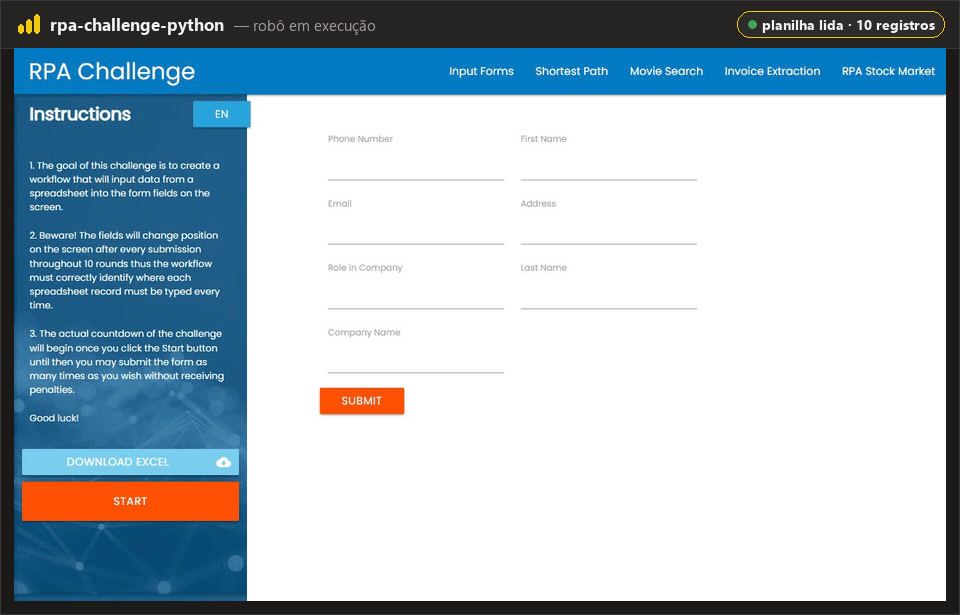</a>
  <a href="https://github.com/rayrafaneli/robo-catalogo-excel">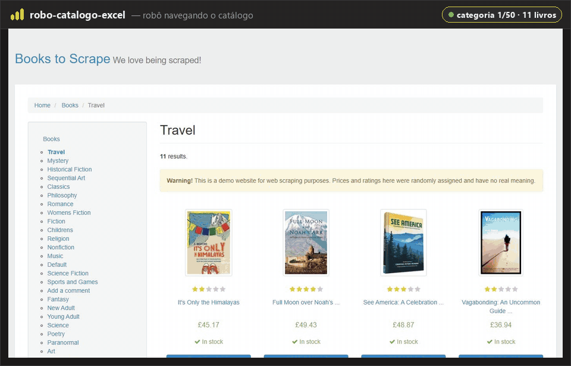</a>
</p>

<br/>

<h2 id="metricas"></h2>

<p align="center">
  
</p>

<p align="center">
  <picture>
    <source media="(prefers-color-scheme: dark)" srcset="https://raw.githubusercontent.com/rayrafaneli/rayrafaneli/output/snake-dark.svg" />
    <source media="(prefers-color-scheme: light)" srcset="https://raw.githubusercontent.com/rayrafaneli/rayrafaneli/output/snake.svg" />
    
  </picture>
</p>

<br/>

<h2 id="contato"></h2>

<p align="center">
  Quer conversar sobre <b>engenharia de dados, ciência de dados, BI ou automação</b>? Me chama.
</p>

<p align="center">
  <a href="https://www.linkedin.com/in/raywa-rafaneli/"></a>
  <a href="mailto:raywarafaneli@gmail.com"></a>
  <a href="https://github.com/rayrafaneli"></a>
</p>

<p align="center">
  
</p>
